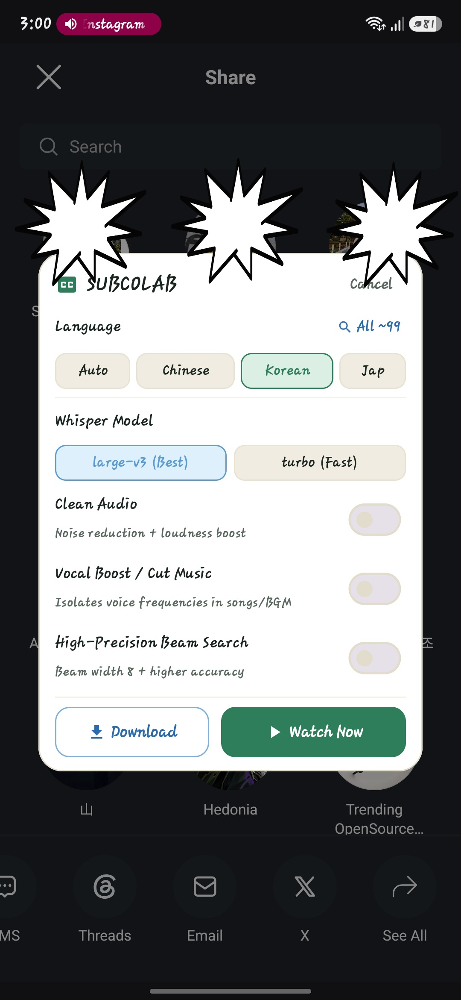

<div align="center">

# SUBCOLAB

**Real-time English subtitles for international, social & offline videos on Android — without browser tabs or Termux**  
Powered by Whisper `large-v3` on your own free Google Colab T4 GPU + built-in `libmpv` player & `yt-dlp`

[](https://github.com/22-db-22/SUBCOLAB/releases)
[-2563EB?style=for-the-badge)](https://github.com/22-db-22/SUBCOLAB/releases)
[-E11D48?style=for-the-badge)](#supported-platforms--media)
[](#supported-platforms--media)
[](LICENSE)

</div>

---

## Why SUBCOLAB?

Apps and regional video sites without built-in subtitle translation—like **Instagram**, **Reddit**, **Local Video Files**, **Dailymotion**, **Bilibili**, **TikTok**, **Vimeo**, **Twitch VODs**, **NicoNico**, and **1,500+ video sites** *(plus **YouTube** and **X** as optional fallbacks when built-in captions are unavailable)*—usually force you into desktop browsers or messy scripts.

**SUBCOLAB v1.0** brings the entire pipeline into a single standalone Android APK: share a link from any app or pick a file from your phone, extract lightweight audio directly on-device, translate speech with **Whisper `large-v3`** on your own **Google Colab T4 GPU**, and watch inside an embedded **`libmpv`** player with live-reloading English subtitles.

---

## Supported Platforms & Media

Powered by an embedded [`youtubedl-android`](https://github.com/yausername/youtubedl-android) (`yt-dlp` + `ffmpeg` + `aria2c`) engine, SUBCOLAB prioritizes platforms that lack built-in translation, alongside offline media and optional fallbacks for major sites:

| Priority / Source | Platforms & Media | How SUBCOLAB Helps |
| :--- | :--- | :--- |
| **Social & Community Apps** | **Instagram** (Reels & posts), **Reddit**, **TikTok**, **Facebook Watch** | Share directly via **Share → SUBCOLAB**; automatic phone/Colab relay handles strict app links cleanly |
| **Offline & Local Media** | Device `.mp4`, `.mkv`, `.webm`, `.mov`, and audio files | Pick any local video on your phone to watch with subtitles and export `.srt` / `.ass` / `.vtt` packs |
| **Regional & Long-Form Video** | **Dailymotion**, **Bilibili**, **Vimeo**, **Twitch** VODs, **NicoNico**, **VK Video**, **Kick**, **OK.ru**, **Rumble**, and 1,500+ extractors | Adaptive 15–60s chunking & seek-ahead jump for dramas, streams, documentaries, and foreign clips |
| **Sites With Built-In Translation *(Optional Fallback)*** | **X (Twitter)**, **YouTube** (`watch`, `shorts`, `live`) | Handy fallback when creator captions or built-in auto-translate are disabled, missing, or inaccurate |

> [!TIP]
> **Redirect Link Unwrapping & Instant GPU Warmup:** SUBCOLAB automatically unwraps Google, Instagram, and Facebook redirect URLs (`google.com/goto?url=...`, `l.instagram.com`, etc.), pre-warms your Colab T4 GPU and Whisper weights in the background after sign-in or Share popup open, and reuses warm sessions across videos.

---

## Screenshots

<p align="center">
  
  
  
  
</p>

<p align="center">
  
  
  
  
</p>

---

## Core Features (`v1.0`)

- **Native Standalone Android App:** Built with Kotlin + Jetpack Compose + Material 3 (`arm64-v8a`, Android 8.0+)—zero browser tabs or Termux required.
- **Single-Frame Share Overlay:** Share from **Instagram, Reddit, Dailymotion, Bilibili, your browser, or other video apps → SUBCOLAB** to configure everything on one compact screen without scrolling:
  - One-row quick language presets (**Auto**, **Chinese**, **Korean**, **Jap**) plus searchable **All ~99** Whisper languages.
  - Whisper model toggle: **`large-v3 (Best)`** or **`turbo (Fast)`**.
  - Built-in audio & accuracy toggles: **Clean Audio** (noise reduction + loudness boost), **Vocal Boost / Cut Music** (isolates speech over songs/BGM), and **High-Precision Beam Search** (beam width 8).
- **Two Workflows (`Watch Now` & `Download`):**
  - **Watch Now:** Streams directly via a local `127.0.0.1` loopback proxy with adaptive `15s–60s` audio-only Whisper chunks and automatically opens `libmpv` as soon as the first English subtitles arrive.
  - **Download:** Saves a `<=720p` `.mp4` *(or re-download at 360p/480p/720p/1080p)* plus `.srt`, `.ass`, and `.vtt` subtitle files to `Downloads/SUBCOLAB/<title>/`.
- **Smart Multi-Video Queue & Non-Interrupting Switching:**
  - Sharing additional videos while a job runs queues them in order (**Queued No. 1**, **Queued No. 2**, ...) with dedicated queue cards that promote automatically when the active job finishes.
  - Queued **Watch Now** videos never cut off what you are currently watching—when ready, a top Android notification and in-app card let you tap **Watch Now** *(stops current video and switches immediately)* or **Cancel Job** *(cancels and starts the next item in queue)*.
- **Rich Downloads Manager With Thumbnails:**
  - Displays video thumbnails (or auto-extracted first video frames) for instant visual recognition.
  - Preserves **canceled jobs** alongside completed packs so you can re-fetch video or regenerate/improve subtitles anytime *(including custom model, audio toggles, optional original-language tracks, and character/context name prompts)*.
- **Fast Colab T4 Execution & Smart Subtitles:**
  - Pre-warms Colab T4 runtimes and stages Whisper models ahead of time, adopts slow-booting runtimes automatically, uses IPv4-first DNS, and recovers automatically from transient Colab tunnel/runtime drops.
  - Automatically detects existing creator captions when present (loading English or fast-translating manual tracks locally in seconds to save GPU time) and uses adaptive Colab relay when mobile links block direct access.
- **Cinema-Grade `libmpv` Player:**
  - Hardware-accelerated video decoding, live `sub-reload`, **Seek-Ahead Jump** for scrubbing ahead to untranslated sections, live CC size/border/box & `±` timing offset adjustments, background saving mid-watch, fullscreen, and Picture-in-Picture (PiP).
- **Polished Customization & Diagnostics:**
  - **System / Light / Dark** themes *(defaults to **System**)*, permanently dismissible **Quick Tips**, real-time debug log viewer, and crash/debug report export.

---

## How It Works

```text
┌─────────────────────────────────────────────────────────────────────────────┐
│  Android Phone (Single Standalone APK — Kotlin + Jetpack Compose)           │
│                                                                             │
│  1. Share / Paste URL (Instagram, Reddit, Local File, Dailymotion, Bilibili)│
│       │                                                                     │
│       ▼                                                                     │
│  2. Embedded yt-dlp + Loopback HTTP Proxy (127.0.0.1) + Sequential Queue    │
│       ├──► Video Stream / Cached Chunks / Local URI ──► Embedded libmpv     │
│       └──► Adaptive 15–60s Audio-Only Chunks (.aac)     ▲  (live            │
│                 │                                       │   sub-reload)     │
└─────────────────┼───────────────────────────────────────┼───────────────────┘
                  │ HTTPS / WebSocket (IPv4-first + Auto-Recover)
                  ▼                                       │
┌─────────────────────────────────────────────────────────┼───────────────────┐
│  Your Google Colab T4 GPU Session (Zero Developer Servers)                  │
│                                                                             │
│  3. Pre-warmed Whisper large-v3 / turbo ──► Live EN (and optional orig) SRT │
└─────────────────────────────────────────────────────────────────────────────┘
```

---

## Download & Quick Start

1. Download **`SUBCOLAB-v1.0-arm64-v8a.apk`** from **[GitHub Releases](https://github.com/22-db-22/SUBCOLAB/releases)** or **[GitHub Actions](https://github.com/22-db-22/SUBCOLAB/actions)** *(Android 8.0+, 64-bit `arm64-v8a`)*.
2. Tap the `.apk` to install *(allow **Install unknown apps** if prompted)*.
3. Open **SUBCOLAB**, allow **Notifications** *(and optionally **Display over other apps** so Watch Now pops open automatically over other apps)*.
4. Go to **Settings → Sign in with Google** to authorize your own Google Colab session *(one-time setup; auto-warms your T4 GPU)*.
5. Share a video from **Instagram, Reddit, Dailymotion, Bilibili, or your browser → SUBCOLAB** *(or pick a local file / paste a URL from TikTok, Vimeo, X, or YouTube)*, choose your options, and tap **Watch Now** or **Download**.

---

## Player Controls & Gestures

Inside the cinema-black `libmpv` player:

| Gesture / Control | Action |
| :--- | :--- |
| **Vertical Swipe (Left Half)** | Adjust screen brightness smoothly |
| **Vertical Swipe (Right Half)** | Adjust media volume smoothly |
| **Double-Tap Left / Right** | Seek backward / forward `10s` |
| **Scrub Timeline Ahead** | Triggers **Seek-Ahead Jump** on Colab from your target timestamp |
| **CC Style & Sync Drawer** | Adjust subtitle font size, border/box style, and timing offset without reloading video |
| **Download Icon** | Save `<=720p` `.mp4` + `.srt` / `.ass` / `.vtt` in the background while watching |
| **CC Toggle / Fullscreen / PiP** | Switch English / off *(or original when generated)*, fullscreen, or Picture-in-Picture |

---

## Privacy & Colab Limits

> [!NOTE]
> **Zero developer servers:** Your Google OAuth2 tokens stay encrypted on your device via Android `EncryptedSharedPreferences` and talk strictly to Google / your own Colab runtime.

- Runs on Google Colab's free T4 GPU tier, so standard Google Colab session duration and daily GPU quotas apply.
- Keep the **T4 GPU warm** between videos for fast starts with `large-v3` already cached in VRAM.
- For private or login-gated videos (e.g., private Instagram links, Vimeo showcases, NicoNico, Bilibili HD, or age-restricted links), import a Netscape `cookies.txt` file in **Settings**.

---

## Future Upgrades & Contributor Roadmap

Planned enhancements where contributions are welcome at **[github.com/22-db-22/SUBCOLAB](https://github.com/22-db-22/SUBCOLAB)**:

- **Android TV / Google TV Support:** Leanback launcher entry, D-pad/remote navigation, and living-room subtitle scaling in `libmpv`.
- **Target Output Languages Beyond English:** Translate captions into Hindi, Spanish, Arabic, Japanese, Korean, and more alongside English.
- **Direct MPEG-DASH (`.mpd`) & Livestream Tailing:** Native `.mpd` rewriting inside `LoopbackMediaProxy` plus continuous sliding-window translation for live broadcasts.
- **On-Device Offline Mode (`whisper.cpp`):** Optional quantized local models (`tiny` / `base` / `small`) for short clips with zero internet or Colab dependency.
- **In-App Stream Sniffer & Speaker Diarization:** Optional WebView extractor for embedded `.m3u8`/`.mpd` streams plus speaker labels (`[Speaker 1]`) for interviews and podcasts.

Contributions, forks, and pull requests are welcome!

---

## License & Attributions

- Repository: **[github.com/22-db-22/SUBCOLAB](https://github.com/22-db-22/SUBCOLAB)**
- Distributed under **[GPL-3.0](LICENSE)**. See **[NOTICE](NOTICE)** for full third-party credits and open-source licenses.
- Based on & inspired by [OpenScribe](https://github.com/faisal-saddique/openscribe) (MIT) by Faisal Saddique.
